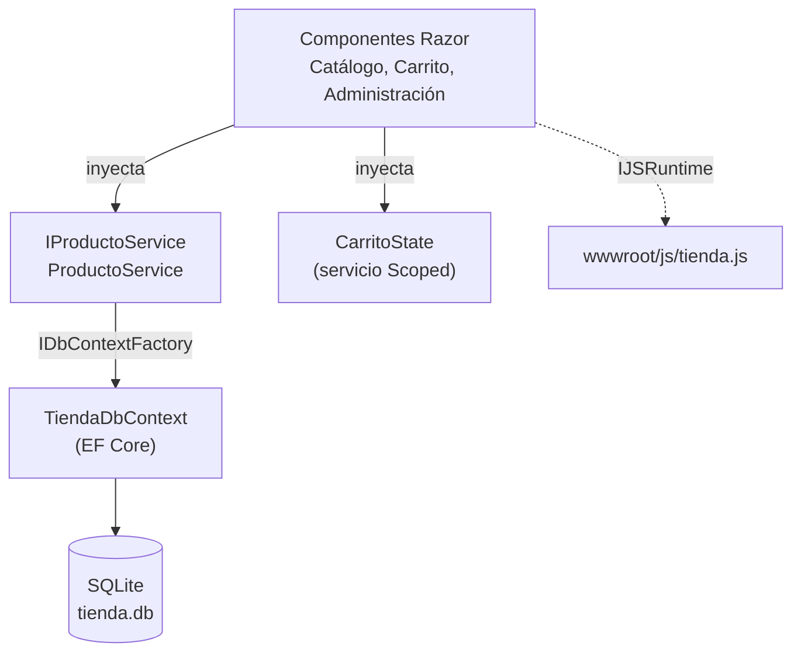

# Tienda de Instrumentos - Blazor

<!-- El badge de build se agrega en el paso de CI/CD -->

Aplicación web para la venta de instrumentos musicales, construida con **Blazor Server** y **Entity Framework Core**. Proyecto Integrador del curso *Desarrollo Web con Blazor* (Espacio de Definición Institucional).

## Funcionalidades

- Catálogo de productos con búsqueda por nombre o marca, filtro por categoría y paginación
- Página de detalle de cada producto (`/producto/{id}`)
- Carrito de compras con control de stock
- Panel de administración: alta, edición y eliminación de productos con validación
- Modo oscuro con persistencia entre sesiones
- Copiar enlace de un producto y notificación del navegador por stock bajo (JS Interop)
- Diseño responsive, pensado desde el celular (mobile-first)

## Capturas

| Catálogo (modo claro) | Catálogo (modo oscuro) |
|---|---|
|  |  |

| Administración | Vista en celular |
|---|---|
|  |  |

## Stack tecnológico

- **Frontend:** Blazor Server (.NET 10), HTML5 semántico, Bootstrap 5, CSS Isolation
- **Datos:** Entity Framework Core 10, SQLite
- **Validación:** Data Annotations
- **Interoperabilidad:** módulos ES6 con `IJSRuntime`

## Arquitectura



## Requisitos

- [.NET 10 SDK](https://dotnet.microsoft.com/download)
- Git

## Instalación

```bash
git clone https://github.com/mateo1705/tienda-instrumentos-blazor.git
cd tienda-instrumentos-blazor
dotnet restore
dotnet run
```

Al iniciar, la aplicación aplica las migraciones y crea la base `tienda.db` con datos de ejemplo (5 categorías y 10 productos). No hace falta instalar ningún servidor de base de datos.

Para aplicar las migraciones manualmente:

```bash
dotnet tool install --global dotnet-ef
dotnet ef database update
```

## Estructura del proyecto

```
Components/
  Layout/         Layout principal y menú
  Pages/          Páginas: catálogo, detalle, carrito, administración
Data/             DbContext de EF Core
Models/           Entidades (ProductoEntity, Categoria, ItemCarrito)
Services/         IProductoService, CarritoState
Migrations/       Migraciones de EF Core
wwwroot/js/       Módulo JavaScript para JS Interop
```

## Configuración

La cadena de conexión está en `appsettings.json`:

```json
"ConnectionStrings": { "Default": "Data Source=tienda.db" }
```

También se puede definir con la variable de entorno `ConnectionStrings__Default`.

## Flujo de trabajo

- Ramas: `main` (producción), `develop` (integración) y `feature/*` (cada funcionalidad)
- Commits con [Conventional Commits](https://www.conventionalcommits.org/es/): `feat`, `fix`, `docs`, `refactor`, `chore`
- Cambios mediante Pull Request hacia `develop`

## Autor

[@mateo1705](https://github.com/mateo1705)
